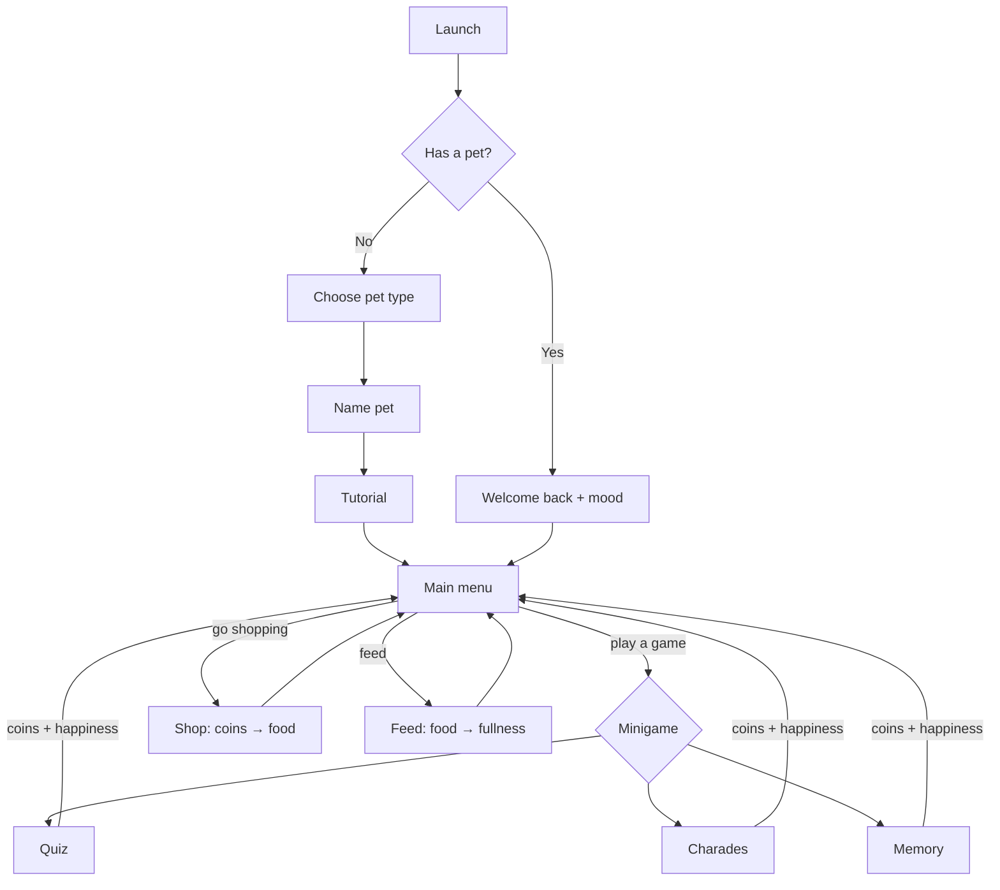

# Pixel Pals

<p>
  
  
  
</p>

A voice-first virtual pet for Alexa, written in TypeScript with [Jovo v4](https://www.jovo.tech).
Adopt a dog, cat or bunny, name it, and keep it full and happy: play minigames to earn coins,
spend coins on food at the shop, and feed your pet. Pets get hungrier and more bored while you
are away, and devices with a screen show the pet and its stats.

The skill runs on the Alexa development stage; it is not published to the Alexa Skills Store.

## Sample conversation

> **You:** Alexa, open pixel pet pals<br>
> **Alexa:** Welcome to Pixel Pals, where you raise your very own virtual pet! Would you like to adopt a dog, a cat, or a bunny?<br>
> **You:** Bunny<br>
> **Alexa:** A bunny, great choice! What would you like to name your bunny?<br>
> **You:** Call it Biscuit<br>
> **Alexa:** Say hello to Biscuit! … Biscuit is a little hungry right now, and you have one snack to start with. What would you like to do: play a game, feed Biscuit, or go shopping?<br>
> **You:** Feed Biscuit<br>
> **Alexa:** Yum! Biscuit gobbles it up and is now 70 percent full. You have 0 food left. …<br>
> **You:** Play charades<br>
> **Alexa:** Let's play charades! I'm thinking of an animal. Guess what it is, or say hint for another clue. First clue: It moves slowly.<br>
> **You:** Hint<br>
> **Alexa:** Next clue: It can live a very long time.<br>
> **You:** Turtle<br>
> **Alexa:** Yes, it's a turtle! You earned 10 coins and now have 20. Biscuit loved playing with you! …<br>
> **You:** Go shopping<br>
> **Alexa:** Welcome to the pet supply store! Pet food costs 10 coins, and you have 20. Would you like to buy some?

## How it works



- **Conversation flow** is a set of Jovo components, one per screen of the game; global
  handlers make "menu", "help" and "stop" work from anywhere.
- **Pet state** (fullness, happiness, coins, food) is plain data with pure functions for
  feeding, rewards and time-based decay, covered by unit tests.
- **Persistence** is per Alexa user: a JSON file locally, DynamoDB in production.
- **Screens** are APL documents, sent only to devices that support them.
- **Voice model** uses closed lists of answer words so single-word replies are recognised reliably.

## Run locally

Jovo's hosted webhook (`webhook.jovo.cloud`) no longer exists, so the Jovo Debugger and the
default `jovo run` tunnel do not work. Use ngrok to give Alexa a public URL instead:

```sh
npm install
npx jovo run --port 3010      # local server (any free port)
ngrok http 3010               # in a second terminal
```

Then set the skill's endpoint to `<ngrok url>/webhook` (Alexa developer console → Build →
Endpoint, with the "wildcard certificate" SSL option). The ngrok URL changes every time ngrok
restarts, and Alexa can take a few minutes to pick up a new endpoint.

Local runs save pets to `db/db.json` (replace its contents with `[]` to start over as a new
user). The production stage (`src/app.prod.ts`) uses DynamoDB.

After changing `models/en.json`, rebuild and upload just the voice model:

```sh
npx jovo build:platform alexa
ask smapi set-interaction-model -s <skill id> -g development -l en-US \
  --interaction-model "file:build/platform.alexa/skill-package/interactionModels/custom/en-US.json"
```

Avoid `jovo deploy:platform alexa`: it uploads the whole generated skill package, which
replaces the endpoint and drops the screen (APL) interface from the skill settings.

## Deploy to AWS Lambda

```sh
npm run bundle:prod           # writes bundle.zip (handler: index.handler)
```

Upload `bundle.zip` to a Node.js Lambda function in `us-east-1` with handler `index.handler`
and an "Alexa Skills Kit" trigger for the skill ID. Its role needs DynamoDB access to the
`pixel-pets` table (`DescribeTable`, `CreateTable`, `GetItem`, `PutItem`); the table is
created on first run. Then set the skill's endpoint to the function's ARN.

## Layout

- `src/components/` – conversation flow (first-time setup, main menu, feed, shop, minigames)
- `src/util/pet.ts` – pet state: hunger, happiness, coins, food, decay over time
- `src/apl/` – screens for devices with a display
- `copy/minigames/` – quiz questions, charades clues, memory animals
- `models/en.json` – voice model
- `test/` – unit tests (`npm test`)
